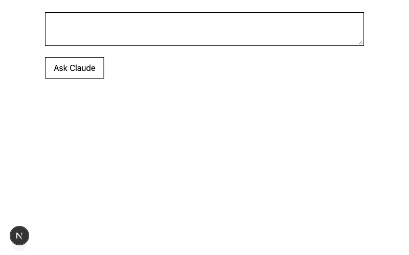

# Claude Dev Journal



Streams Claude responses token-by-token via a Next.js route handler (`ReadableStream`), with an abort-on-disconnect step that stops paying for tokens nobody reads.

A day-by-day learning journal for my Claude developer course. Each entry records what I learned and built that day. The app itself was built with [Claude Code](https://claude.com/claude-code), Anthropic's agentic coding tool.

## Tech stack

- [Next.js](https://nextjs.org) 16 (App Router)
- React 19
- TypeScript
- Tailwind CSS 4
- ESLint

## Running locally

Requires Node.js 20.9 or later.

```bash
git clone https://github.com/Arjunsr56/claude-dev-journal..git
cd claude-dev-journal.
npm install
npm run dev
```

Then open [http://localhost:3000/journal](http://localhost:3000/journal).

Journal entries live in [`app/journal/entries.ts`](app/journal/entries.ts).

The routine tracker at [`/tracker`](http://localhost:3000/tracker) is a daily checklist for my scheduled Claude routines, defined in [`app/tracker/routines.ts`](app/tracker/routines.ts). Ticks are saved in the browser's `localStorage`, so they stay on the device you tick them on. A progress dashboard at [`/tracker/dashboard`](http://localhost:3000/tracker/dashboard) shows completion rates, streaks and an activity grid for each routine.

## Progress

| Day | Date       | Topic                                      |
| --- | ---------- | ------------------------------------------ |
| 1   | 2026-10-16 | Claude models + Claude Code setup          |
| 2   | 2026-10-17 | CLAUDE.md memory files                     |
| 3   | 2026-10-18 | Skills and custom slash commands           |
| 4   | 2026-10-22 | Hooks: deterministic guardrails            |
| 5   | 2026-10-22 | Subagents: a read-only code reviewer       |
| 6   | 2026-10-23 | MCP servers, scopes and my first plugin    |
| 7   | 2026-10-24 | Headless mode and GitHub Actions           |
| 8   | 2026-10-26 | MCP concepts                               |
| 9   | 2026-10-26 | Building my first MCP server               |
| 10  | 2026-10-26 | Messages API fundamentals (TypeScript SDK) |
| 11  | 2026-10-26 | Prompt engineering                         |
| 12  | 2026-10-29 | Streaming Claude responses                 |
| 13  | 2026-10-29 | Tool use                                   |
| 14  | 2026-10-31 | Structured Outputs with Zod                |
| 15  | 2026-10-31 | Vision & PDFs                              |
